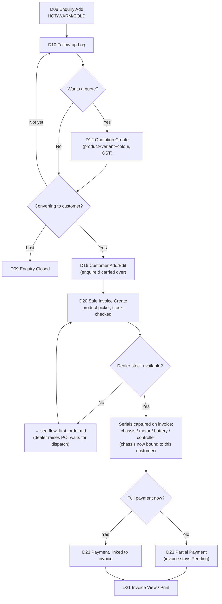

# Customer Flow — Enquiry → Customer → Invoice

IDs reference `docs/feature_catalog.md` (D## dealer). Dealer-owned flow; OEM only sees a read-only mirror throughout (O07/O08/O09).

**Branch points**
| Decision | No / not yet | Yes |
|---|---|---|
| Wants a formal quote? | skip straight to conversion | D12 Quotation first |
| Ready to convert to customer? | keep logging follow-ups (D10) | D16 Customer Add/Edit |
| Dealer has stock for the invoice items? | divert to Purchase flow (`flow_first_order.md`), return once dispatched | continue to invoice |
| Paid in full at invoice time? | invoice status = Pending, partial payments reduce it | invoice status = Paid |

**Side effects, not separate steps:** Enquiry can be reopened (D09) even after closing · Every invoice/payment write hits the audit log · OEM sees all of this read-only via O07/O09, never create/edit.

**Variant not shown above:** a Service job (D41/D42) also produces a `type=SERVICE` invoice through the same D20 screen, priced from the dealer's Service Price List (D26) instead of the product catalog.
