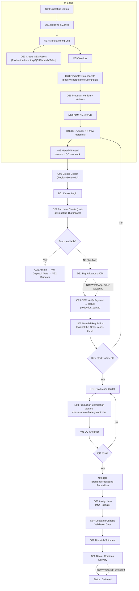

# First Order Flow — Setup → Dealer PO → Manufacture → Dispatch

IDs reference `docs/feature_catalog.md` (D## dealer, O## OEM, N## new). Assumes item is **not in stock** at PO time.

**Branch points**
| Decision | No | Yes |
|---|---|---|
| Stock available at PO time? | this flow (manufacture) | skip straight to Assign → Dispatch |
| Raw material sufficient for requisition? | loop to Vendor PO / Material Inward | proceed to Production |
| QC pass? | back to Production for rework | proceed to Branding/Packaging → Dispatch |

**Side effects, not separate steps:** Ledger credited on any payment surplus · Audit log entry on every write · WhatsApp notification on order-accepted and delivered.
