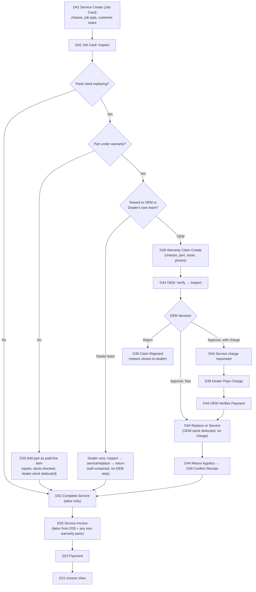

# Service Flow — Request → Parts Replacement → Warranty / No-Warranty

IDs reference `docs/feature_catalog.md`. Dealer-owned job card; warranty branch crosses into the OEM app (O44) when raised there.

**Branch points**
| Decision | Branch A | Branch B |
|---|---|---|
| Parts need replacing? | No → labor-only completion | Yes → warranty check |
| Part under warranty? | No → charged as invoice line item, dealer stock | Yes → warranty claim path |
| Claim raised to? | Dealer's own team — self-contained, no OEM involvement | OEM — full verify/inspect/service workflow (O44) |
| OEM decision on claim | Reject (reason shown) | Approve free, or approve with a service charge to the dealer |

**Side effects, not separate steps:** warranty replacement deducts **OEM** inventory; a non-warranty part deducts **dealer** inventory — different stock pools. Audit log entry on every write. Rejected claims don't block completing the service as a paid job.

**Open question (not resolved by the reference app):** if the OEM charges the dealer a warranty service fee, is that cost passed on to the customer, absorbed by the dealer, or configurable? Worth deciding explicitly — the reference app only shows dealer→OEM payment, not a dealer→customer pass-through rule.
